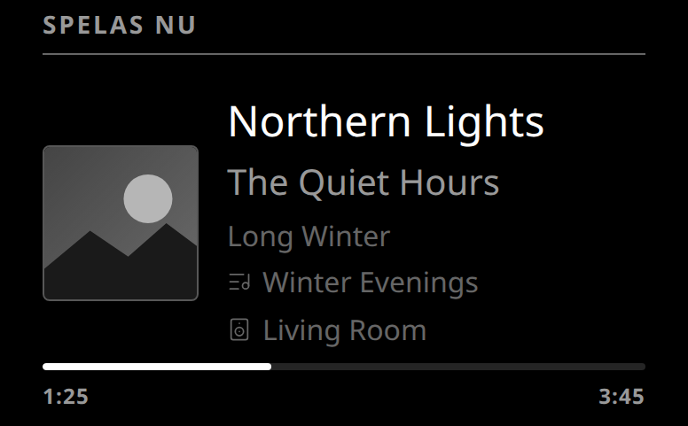

# mirrordash-now-playing-spotify

What's playing on your Spotify right now, on your MirrorDash: the track, artist, album, the playlist it plays
from, the speaker it plays on, the album cover and how far into the track it is. Every part can be turned off.
The card hides when nothing plays (stopped or paused).



## Installation

On the mirror's admin page, open **Modules**: the module is in the list, install it with one click.
Or paste `git+https://github.com/Menturan/mirrordash-now-playing-spotify.git` under **Modules → Install a Module from GitHub**.

## Connect it to your Spotify (once)

Spotify only lets a mirror read what's playing through an app of your own. It needs **Spotify Premium** (Spotify's
rule for apps in development mode, which allow up to 5 users).

1. Go to [developer.spotify.com/dashboard](https://developer.spotify.com/dashboard), log in and choose **Create app**.
2. Give it any name and description, e.g. *My mirror*. Under **Redirect URIs** enter exactly
   `http://127.0.0.1:8888/callback` and choose **Add**. Under *Which API/SDKs are you planning to use?* tick
   **Web API**. Accept the terms and **Save**.
3. Open the app's **Settings** and copy its **Client ID**. (No Client Secret is needed.)
4. On the mirror's admin page, open the module's settings, paste it into **Client ID** and save.
5. The card now shows a QR code and its login address (`http://<the mirror's address>/api/modules/<instance>/login`).
   Scan it with a phone on the same network (or type the address), log in to Spotify and accept.
6. Your browser then lands on `http://127.0.0.1:8888/callback?code=…` and says it can't open the page. That is
   expected: copy that whole address from the address bar, paste it into **Login Address** in the module's settings
   and save.

The module keeps the login in its own data folder from then on. If Spotify ever asks you to log in again (the
card says so), repeat steps 5 and 6.

## Settings

| Setting | What it does |
| :--- | :--- |
| Client ID | Your Spotify app's Client ID (step 3). |
| Login Address | The address you landed on after logging in (step 6). |
| Update Interval | Seconds between asking Spotify what's playing (10). The bar moves every second in between. |
| Show Header | The "Now playing" title. |
| Show Track / Artist / Album | Each line on its own; the first one shown is the big white one. |
| Show Playlist | The playlist it plays from, or *Liked Songs*. Spotify's own playlists (Discover Weekly, …) can't be read by apps, so no line for those. |
| Show Device | The speaker, phone or computer it plays on. |
| Show Cover | The album (or podcast) cover. |
| Cover | Black and white (calmer through the glass) or colour. |
| Show Progress | A bar with the time played and the track's length. |

Podcast episodes show the podcast's name in place of the artist.

## Develop

```bash
uv run pytest                    # the module's tests
uvx mirrordash-sdk validate .    # checks the module before you push it
```

## License
[MIT](LICENSE)
